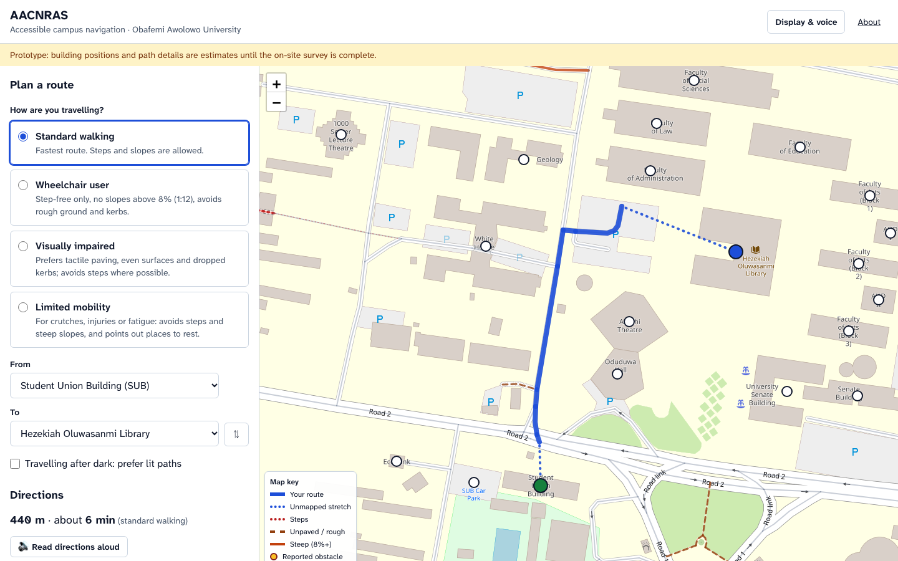

# SWEP Group 15 — Obafemi Awolowo University

This repository holds SWEP Group 15's three campus projects for Obafemi Awolowo University, Ile-Ife. Each project is a self-contained web app in its own folder, with its own README, tests and setup.

| Folder | Project | What it does | Status |
| --- | --- | --- | --- |
| [`aacnras/`](aacnras/README.md) | **Accessibility-Aware Campus Navigation and Route Advisory System** | Plans routes across campus for how each person moves (walking, wheelchair, visually impaired, limited mobility), with warnings, an elevation profile, building accessibility details and verified obstacle reports | MVP done |
| [`sctpstvs/`](sctpstvs/README.md) | **Secure Campus Transport Payment and Single-Use Ticket Verification System** | Students pay for campus shuttle rides from a wallet and get signed, single-use QR tickets that conductors scan, so fake or reused tickets are rejected | MVP in progress |
| [`ppclfmvrs/`](ppclfmvrs/README.md) | **Privacy-Preserving Campus Lost-and-Found Matching and Verified Recovery System** | Matches lost and found reports automatically, and hands items over only after the owner proves ownership, without exposing either side's private details | MVP in progress |



## Running a project

Every project needs **Node.js 22 or newer**. Run these from the repository root, replacing `<folder>` with the project folder:

```bash
cd <folder>
npm install
npm run dev     # development server
npm test        # unit tests
```

Each project's README covers its demo accounts, configuration, how it works and its limitations.

## Shared conventions

- **Stack:** Next.js 16 (App Router), React 19, TypeScript, Tailwind CSS 4 and Vitest.
- **Accessible by default:** semantic HTML, labelled controls, visible focus, good contrast, phone-first layouts.
- **No real payments or personal data in demos:** demo accounts, demo wallet top-ups and seed data only.
- **Runtime data** (reports, tickets, claims) lives in each project's `data/` folder, which git ignores.

## Repository layout

```
swep-g-15/
├── README.md        ← this overview
├── docs/            screenshots used in the READMEs
├── aacnras/         accessible campus navigation
├── sctpstvs/        transport payment and single-use tickets
└── ppclfmvrs/       lost-and-found matching and verified recovery
```

## Credits

Built by SWEP Group 15, Obafemi Awolowo University, Ile-Ife, as part of the Students' Work Experience Programme. Map data © [OpenStreetMap contributors](https://www.openstreetmap.org/copyright) (ODbL).
