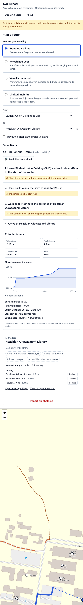

# AACNRAS: Accessible Campus Navigation for OAU

**Accessibility-Aware Campus Navigation and Route Advisory System** for Obafemi Awolowo University, Ile-Ife.
A SWEP Group 15 project. [Back to all group projects](../README.md).

AACNRAS plans walking routes across the OAU campus for the way each person actually moves. A wheelchair user gets a step-free route with no slopes steeper than 1:12. Someone on crutches is kept off long climbs. A visually impaired student is steered away from busy roads. Every route comes with turn-by-turn directions, warnings about what lies ahead, an elevation profile and details about the destination building. Anyone can report a blocked path or a broken lift, and once an admin verifies the report, routes avoid it.


## Contents

- [The problem](#the-problem)
- [Features](#features)
- [Quick start](#quick-start)
- [Using the app](#using-the-app)
- [How routing works](#how-routing-works)
- [Data](#data)
- [Survey checklist](#survey-checklist)
- [Project structure](#project-structure)
- [API reference](#api-reference)
- [Configuration](#configuration)
- [Testing](#testing)
- [Deployment](#deployment)
- [Limitations and future work](#limitations-and-future-work)
- [Credits and licence](#credits-and-licence)

## The problem

The OAU campus is large and hilly. Many routes between faculties, halls and offices include steps, steep roads, uneven or unpaved ground and stretches that are dark at night. General-purpose map apps give everyone the same route, which can:

- leave a wheelchair user at the bottom of a staircase,
- send someone with a leg injury up a long hill when a gentler route exists,
- guide a visually impaired student along a busy road with no dropped kerbs.

Accessibility information for campus buildings, such as which have ramps, lifts or accessible toilets, is also not written down anywhere students can find it. AACNRAS brings routes and building information together in one place and lets the campus community keep them up to date.

## Features

### Route planning
- **Four travel profiles:** standard walking, wheelchair user, visually impaired and limited mobility. Each profile has its own rules for steps, slopes, surfaces, kerbs, traffic and walking speed. See [Travel profiles](#travel-profiles).
- **Accessible route finding:** an A\* search over the real OAU path network. It finds the route with the lowest *cost* for your profile, which is not always the shortest one.
- **After-dark mode:** prefers paths with street lighting.
- **79 campus places**, grouped by category: faculties and lecture theatres, halls of residence, banks, health, food and shops, places of worship, car parks, sports and student life.

### Route advisory
- **Turn-by-turn directions:** for example "Head north along the service road for 280 m", then "Turn left onto Road 2…".
- **Warnings at each step:** steps, moderate (5%+) and steep (8%+) slopes, rough or unpaved ground, missing dropped kerbs, unlit paths and obstacle reports.
- **Unmapped stretches:** when a building sits away from the mapped paths, directions say so: "Walk about 120 m to the entrance… this stretch is not on the map yet".
- **Read aloud:** directions can be spoken by the device, on request or automatically.

### Route details
- An **elevation profile chart**. Hover over it, or use the arrow keys, to read the elevation at any point, or open it as a table.
- Total **climb and descent**, the **steepest section** and the **number of steps**.
- How much of the route is **paved, rough or unpaved**, on **footpaths or roads**, and **lit, unlit or unrecorded**.
- **Landmarks you'll pass** on the way.

### Building details
- **Accessibility features:** step-free entrance, ramp, lift and accessible toilet. Each shows *yes*, *no* or *not surveyed*.
- From OpenStreetMap where it's recorded: **floors, opening hours, phone, website, cuisine and operator**.
- **What's inside** (departments and offices) once surveyed.
- Any **open obstacle reports** for the building.
- The **three nearest places**, each with a "Go here" button.
- Links to **Google Maps walking directions** and the building's **OpenStreetMap** page.

### Obstacle reports and admin
- Anyone can **report an obstacle**: a blocked path, construction work, flooding, a broken lift, a damaged ramp or another hazard. They choose the spot on the map or the nearest building.
- A new report appears straight away as an **unverified warning** on any route that uses that path.
- An **admin dashboard** at `/admin`, protected by a passcode, lets staff **verify**, **reject** or **resolve** reports. Verified reports that block a path take it out of routing until they are resolved.

### Accessible by design
- **High-contrast mode** and **three text sizes** (normal, large, extra large), remembered on each device.
- **Keyboard and screen-reader friendly:** a skip link, labelled controls, live regions for route updates, and visible focus rings. Every map action can also be done from the side panel.
- Set in **Atkinson Hyperlegible**, a typeface designed by the Braille Institute for low-vision readers.
- Map lines use **dash patterns as well as colour**, so they can be read without colour vision.
- Respects **reduced-motion** settings.
- Works on phones: the map moves below the planner on small screens.

<p align="center">
  
</p>

## Quick start

### Requirements
- **Node.js 22** or newer (check with `node -v`)
- npm, which comes with Node.js

### Run it locally

```bash
cd aacnras
npm install
npm run dev
```

Open <http://localhost:3000>.

### Test it on phones on the same Wi-Fi

The development server is slow on phones. Use a production build instead:

```bash
cd aacnras
npm run build
npx next start -H 0.0.0.0 -p 3015
```

Find your computer's local IP address (on macOS run `ipconfig getifaddr en0`), then open `http://<that-ip>:3015` on the phone.

### All commands

Run these inside `aacnras/`:

| Command | What it does |
| --- | --- |
| `npm run dev` | Start the development server with hot reload |
| `npm run build` | Build the production version |
| `npm start` | Serve the production build |
| `npm test` | Run the unit tests (Vitest) |
| `npm run lint` | Check the code with ESLint |
| `npm run import:osm` | Re-download paths, places and elevations from OpenStreetMap and Open-Meteo |

## Using the app

### Plan a route
1. Under **How are you travelling?**, choose a profile. The app remembers your choice on that device.
2. Pick **From** and **To**, or tap a building on the map and choose **Start here** or **Go here**. The ⇅ button swaps the two.
3. Tick **Travelling after dark** if you want lit paths.
4. Read the directions, the warnings and the **Route details**. Press **Read directions aloud** to hear them.

If no route suits the chosen profile, for example because the only step-free way in is blocked, the app says so and suggests trying another profile or asking for assistance.

### Look up a building
The panel below the directions describes the destination. To see another building, tap it on the map and choose **Details**, or press **Go here** next to a nearby place.

### Report an obstacle
1. Press **Report an obstacle**.
2. Choose whether it's about **a path** or **a building**.
3. For a path, pick the nearest building, or press **Pick the exact spot on the map** and tap the map. The chosen path is highlighted.
4. Choose the problem type, add details if you like, and press **Send report**.

### Review reports (admin)
Go to `/admin`. There is no link from the main page. Sign in with the admin passcode (see [Configuration](#configuration)), then filter by status and press **Verify**, **Reject** or **Mark resolved**.

| Report type | Effect once verified |
| --- | --- |
| Path blocked, Construction work, Flooding, Ramp damaged or blocked | The path is **removed from routing** |
| Lift not working, Other hazard | Shown as a **warning** only |

Reports that are *pending* show as warnings. Reports that are *rejected* or *resolved* are hidden.

## How routing works

### 1. The campus as a graph
The campus is a **graph**. **Nodes** are junctions and path ends; **edges** are the walkable segments between them. Every edge stores:

| Attribute | Meaning |
| --- | --- |
| `length` | Metres along the path |
| `geometry` | The path's shape, as a list of points |
| `elevation` | Terrain height at each point |
| `slopePercent` | Steepest gradient on the segment (8% ≈ the 1:12 ramp limit) |
| `steps` | Number of steps (0 = step-free) |
| `surface` | `paved`, `rough` or `unpaved` |
| `highway` | Path type from OpenStreetMap (footway, steps, service road, tertiary road…) |
| `lit`, `tactilePaving`, `kerbRamps` | `true`, `false`, or `null` when not recorded |

Each place is attached ("snapped") to the nearest node in the main connected network, so every place can be reached.

### 2. A cost for each person
Each profile turns an edge into a **cost in effective seconds**. First, some edges are ruled out entirely:
- the edge has steps and the profile doesn't allow steps, or
- the edge is steeper than the profile's maximum slope.

Otherwise:

```
cost = (length ÷ speed)
     × (1 + slopePercent × slopeFactor)
     × surfacePenalty[surface]
     × noKerbRampPenalty   if the path is known to have no dropped kerbs
     × noTactilePenalty    if the path has no recorded tactile paving
     × busyRoadPenalty     if it is a main road (secondary or tertiary)
     × 3                   after dark, if known to be unlit
     × 1.5                 after dark, if lighting is not recorded
     + steps × stepPenalty
```

Every multiplier is at least 1, so an edge never costs less than the time it takes to walk it.

### 3. The A\* search
A\* explores the graph from the start and always expands the node with the lowest *cost so far + estimated cost to the goal*. The estimate is the straight-line distance to the destination divided by the profile's speed. That estimate can never be more than the true cost, so A\* is guaranteed to find the lowest-cost route while exploring far fewer nodes than a blind search. Edges blocked by verified reports are skipped.

### 4. From path to advice
The chosen path becomes directions:
- Consecutive segments of the same path are merged into one instruction.
- Turns come from the change in heading between segments: under 30° is "Continue", 30–60° is "Bear left/right", 60–150° is "Turn left/right", and more is "Turn around".
- Warnings are added per step, plus any pending or verified reports on those segments.
- Walking legs are added where the start or destination is more than 25 m from the mapped network.
- The **time estimate** uses the profile's speed, adds 3% per percent of slope, and adds time per step. This is separate from the routing cost, so the estimate stays realistic.

### Travel profiles

| | Standard walking | Wheelchair user | Visually impaired | Limited mobility |
| --- | --- | --- | --- | --- |
| Speed | 1.3 m/s (4.7 km/h) | 0.9 m/s (3.2 km/h) | 1.0 m/s (3.6 km/h) | 0.7 m/s (2.5 km/h) |
| Steps | Allowed | **Never** | Avoided (+4 s each) | Avoided (+10 s each) |
| Maximum slope | Any | **8%** | Any | **10%** |
| Slope factor (per %) | 0.02 | 0.10 | 0.03 | 0.08 |
| Surface penalty (paved / rough / unpaved) | 1 / 1.1 / 1.2 | 1 / 2.5 / 4 | 1 / 1.5 / 2 | 1 / 2 / 3 |
| No dropped kerbs | ×1 | ×3 | ×1.5 | ×1.5 |
| No tactile paving | ×1 | ×1 | ×1.3 | ×1 |
| Busy road | ×1 | ×1.15 | ×1.4 | ×1.1 |
| Time per step | 0.6 s | — | 1.2 s | 2.5 s |

These values are in `aacnras/src/lib/profiles.ts` and are easy to tune after testing with real users.

## Data

| Data | Source | File | Status |
| --- | --- | --- | --- |
| Paths, roads, steps | [OpenStreetMap](https://www.openstreetmap.org) via the Overpass API | `src/data/osm-network.json` | Real; some footpaths near buildings are not yet mapped |
| Elevation and slopes | Copernicus DEM GLO-90 via [Open-Meteo](https://open-meteo.com) | `src/data/osm-network.json` | Estimates (90 m resolution) |
| Places, opening hours, floors, phone numbers | OpenStreetMap | `src/data/osm-places.json` | Real where mapped |
| Curated key buildings and descriptions | The group | `src/data/campus.ts` | Done |
| Building accessibility features | On-site survey | `src/data/campus.ts` | **Not surveyed yet** |
| Path corrections | On-site survey | `src/data/campus.ts` (`pathCorrections`) | **Not surveyed yet** |
| Benches and shelters | On-site survey | `src/data/campus.ts` (`restPoints`) | **Not surveyed yet** |

A banner reads "Prototype" until `DATA_VERIFIED` is set to `true` in `src/data/campus.ts`.

### The import pipeline (`npm run import:osm`)
1. Downloads every walkable way (footways, paths, steps, roads, tracks) inside the campus bounding box from OpenStreetMap.
2. Splits ways into edges at junctions shared between ways and at way ends, keeping the full shape of each edge.
3. Reads surface, lighting, tactile paving, kerb and step-count tags where present, with sensible defaults where not.
4. Fetches the terrain elevation of every point from Open-Meteo, in batches, with retries if the service is busy.
5. Estimates each edge's slope as the steepest gradient over stretches of at least 90 m. The terrain model has 90 m cells, so shorter stretches would only measure noise.
6. Downloads every named building and amenity, keeping useful tags like `opening_hours` and `building:levels`.

The curated places in `campus.ts` are linked to OpenStreetMap features by ID, for example `w617712369` for the library. If a later import no longer contains that feature, the app stops with a clear error instead of putting the building in the wrong place.

## Survey checklist

This is fieldwork for the group. Everything is edited in `aacnras/src/data/campus.ts`.

1. **Buildings:** for each place, check the step-free entrance, ramp, lift and accessible toilet, and set `true` or `false` in its `accessibility`. Add useful notes, such as "use the side entrance; the front has steps".
2. **Inside:** list departments, offices and facilities in `inside`.
3. **Paths:** walk the main routes. Correct slopes, steps, surfaces, lighting and kerbs in `pathCorrections`, keyed by OpenStreetMap way ID (applies to the whole way) or edge ID (one segment):
   ```ts
   const pathCorrections: Record<string, Correction> = {
     w123456789: { slopePercent: 9, kerbRamps: false },
     "w123456789-2": { lit: true },
   };
   ```
   To find a path's way ID, open the spot on [openstreetmap.org](https://www.openstreetmap.org), click the path and read the number after "Way" (`w` + that number). You can also search `osm-network.json` for the path's name.
4. **Rest points:** add benches and shelters to `restPoints` (`{ name, lat, lng }`).
5. **Missing footpaths:** where directions say "this stretch is not on the map yet", add the footpath to OpenStreetMap at [openstreetmap.org](https://www.openstreetmap.org), then run `npm run import:osm`. This improves the map for everyone, not just this app.
6. **Team:** add the members' names to `TEAM` in `src/app/about/page.tsx`.
7. When you're done, set `DATA_VERIFIED = true`.

## Project structure

```
swep-g-15/
├── docs/screenshots/             screenshots used in this README
└── aacnras/                      the web app (Next.js) ← this folder
    ├── scripts/
    │   └── import-osm.mjs        OpenStreetMap + elevation importer
    └── src/
        ├── app/
        │   ├── page.tsx          route planner (home page)
        │   ├── about/            About page
        │   ├── admin/            admin dashboard
        │   ├── api/reports/      report list, create and status update
        │   ├── api/admin/login/  admin passcode check
        │   ├── layout.tsx        fonts, skip link, display settings
        │   └── globals.css       colour tokens, high contrast, text sizes
        ├── components/
        │   ├── route-planner.tsx      main screen: profiles, places, directions
        │   ├── campus-map.tsx         Leaflet map: paths, route, places, reports
        │   ├── route-details-panel.tsx climb, surfaces, lighting, landmarks
        │   ├── elevation-chart.tsx    elevation profile (SVG, hover + keyboard)
        │   ├── place-details.tsx      building information card
        │   ├── place-select.tsx       building picker grouped by category
        │   ├── report-form.tsx        obstacle report form
        │   └── settings-*.tsx         text size, contrast, voice
        ├── data/
        │   ├── campus.ts         curated places, survey data, builds the graph
        │   ├── osm-network.json  imported paths with elevation
        │   └── osm-places.json   imported named places
        └── lib/
            ├── routing.ts        edge costs and A* search
            ├── advisory.ts       directions, warnings, time estimates
            ├── route-details.ts  elevation profile and route statistics
            ├── profiles.ts       travel profile rules
            ├── graph.ts          graph building, snapping, nearest path
            ├── places.ts         categories, nearby places, links
            ├── reports.ts        report types and blocking rules
            ├── geo.ts            distances, bearings, compass directions
            ├── settings.ts       per-device preferences
            ├── speech.ts         read-aloud
            ├── server/           report storage and admin check
            └── *.test.ts         unit tests (with a small hand-made test campus)
```

**Tech stack:** Next.js 16 (App Router), React 19, TypeScript, Tailwind CSS 4, Leaflet with react-leaflet, and Vitest.

## API reference

All endpoints are under `/api`. Request and response bodies are JSON.

### `GET /api/reports`
Returns every report, in all statuses.

```json
[
  {
    "id": "e429fbf3-7fcc-433f-b98d-4875863ab000",
    "type": "flooding",
    "description": "Water across the walkway",
    "edgeId": "w387309888-0",
    "lat": 7.5183,
    "lng": 4.5211,
    "status": "pending",
    "createdAt": "2026-10-22T22:47:22.467Z",
    "updatedAt": "2026-10-22T22:47:22.467Z"
  }
]
```

### `POST /api/reports`
Creates a report with status `pending`.

| Field | Required | Notes |
| --- | --- | --- |
| `type` | yes | `blocked`, `construction`, `flooding`, `broken-lift`, `broken-ramp` or `other` |
| `edgeId` or `placeId` | one of them | Must be a known path segment or place |
| `lat`, `lng` | yes | Where the obstacle is |
| `description` | no | Up to 500 characters |

Responses: `201` with the new report, or `400` with `{ "error": "…" }`.

### `PATCH /api/reports/:id`
Changes a report's status. Requires the `x-admin-passcode` header.

```json
{ "status": "verified" }
```

`status` is one of `pending`, `verified`, `rejected` or `resolved`. Responses: `200` with the updated report, `400` for an invalid status, `401` for a wrong passcode, or `404` if no report has that ID.

### `POST /api/admin/login`
Checks the `x-admin-passcode` header. Responses: `200` `{ "ok": true }` or `401`.

## Configuration

| Variable | Default | Purpose |
| --- | --- | --- |
| `ADMIN_PASSCODE` | `oau-swep-15` | Passcode for the admin dashboard and status updates |

Set it in `aacnras/.env.local`, which git ignores:

```bash
ADMIN_PASSCODE=choose-something-long
```

**Change the default before anyone else can reach the app.** The passcode is compared in constant time, but it is a shared secret, not a user account system.

## Testing

```bash
cd aacnras
npm test
```

There are 25 tests in three areas:

- **Routing** (`routing.test.ts`): wheelchair routes never use steps or slopes over 8%; blocked segments are avoided, and a blocked only-way-in gives no route; after-dark mode avoids unlit paths; verified reports block paths while pending ones only warn; turn directions; rest points; destination advisories. These tests run on a **small hand-made test campus** (`test-fixture.ts`) with known stairs, hills and unlit paths, so the expected answers are clear. Further tests check the **real OAU data**: every pair of the 79 places is connected, and every profile can travel between the main faculties.
- **Route details** (`route-details.test.ts`): the elevation profile, climb and descent in both directions, step and surface totals, the steepest section and landmarks.
- **Places** (`places.test.ts`): grouping, nearby places, opening-hours formatting, OpenStreetMap links and unique IDs.

Before committing, also run `npm run lint` and `npx tsc --noEmit`.

## Deployment

The app runs anywhere Node.js 22 runs:

```bash
npm run build
npm start          # add -p <port> -H 0.0.0.0 as needed
```

**Obstacle reports are stored in `aacnras/data/reports.json`.** That works on a single server, such as a laptop for the demo or a VPS. It does **not** work on serverless hosts like Vercel, where the file system is temporary and reports would be lost. Before deploying there, move report storage to a database (Supabase, Postgres or similar). The only file to change is `src/lib/server/report-store.ts`.

## Limitations and future work

**Current limitations**
- Building accessibility features have not been surveyed yet (see the [survey checklist](#survey-checklist)).
- Slopes come from a 90 m terrain model, so short steep ramps or dips can be missed, and the direction of a slope is not used. A climb and a descent cost the same.
- Some footpaths near buildings are not in OpenStreetMap, so routes may end on the nearest road with an "unmapped stretch" note.
- Routes start and end at buildings; you can't start from your current location yet.
- Admin access is a single shared passcode.

**Ideas for later**
- Start routes from the phone's GPS location.
- Treat uphill and downhill differently, which matters for wheelchair users.
- Live guidance that speaks the next instruction as you walk.
- Photos of entrances and ramps on the building cards.
- Yoruba language support.
- Offline mode, so the campus map works without data.
- Individual admin accounts, and a database for reports.

## Credits and licence

Built by **SWEP Group 15**, Obafemi Awolowo University, Ile-Ife, as part of the Students' Work Experience Programme (SWEP).

- Map data © [OpenStreetMap contributors](https://www.openstreetmap.org/copyright), available under the Open Database Licence (ODbL).
- Elevation data from the Copernicus DEM GLO-90, accessed via [Open-Meteo](https://open-meteo.com).
- Map tiles © OpenStreetMap.
- Typeface: [Atkinson Hyperlegible](https://www.brailleinstitute.org/freefont/) by the Braille Institute.

No licence has been chosen for the code yet. Until one is added, all rights are reserved by the authors.
