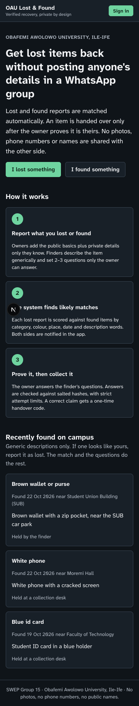
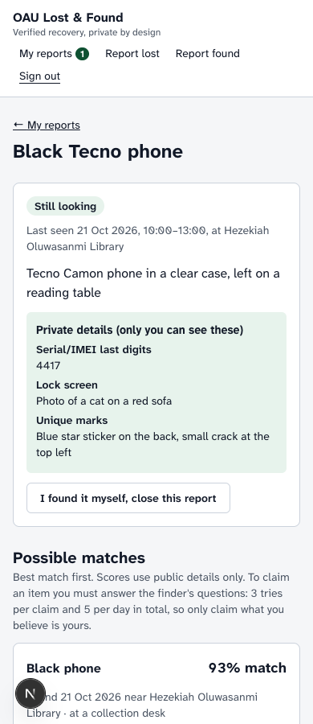
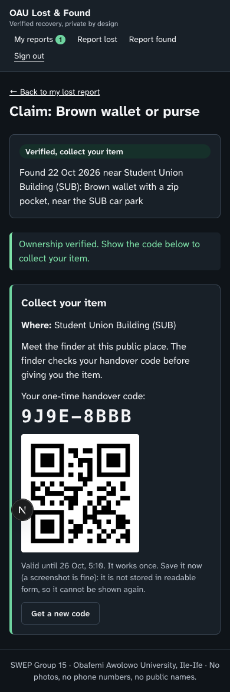

# PPCLFMVRS: Privacy-Preserving Campus Lost-and-Found

**Privacy-Preserving Campus Lost-and-Found Matching and Verified Recovery System** for Obafemi Awolowo University (OAU), Ile-Ife. A SWEP Group 15 project. [Back to all group projects](../README.md).

When students lose phones, ID cards, wallets, keys, laptops or bags on campus, finders usually post photos and full details in WhatsApp groups. That exposes the owner's private information (lock-screen photos, names on cards, account numbers) and lets anyone falsely claim the item. This system matches lost and found reports automatically. It hands an item over only after the claimant proves ownership, and neither side's private details leak to the other or to the public.

<p>
  
  
  
</p>

## Contents

- [Features](#features)
- [Status](#status)
- [How to run](#how-to-run)
- [Configuration](#configuration)
- [Deployment](#deployment)
- [Demo accounts and walkthrough](#demo-accounts-and-walkthrough)
- [How matching works](#how-matching-works)
- [How verification and handover work](#how-verification-and-handover-work)
- [Privacy design](#privacy-design)
- [Concurrency safety](#concurrency-safety)
- [API routes](#api-routes)
- [Project structure](#project-structure)
- [Testing](#testing)
- [Limitations and future work](#limitations-and-future-work)

## Features

- **Accounts:** sign in with a matriculation or staff number and password. Passwords are hashed with Node's `crypto.scrypt` and a per-user salt. Sessions use a random token in an httpOnly, SameSite=Lax cookie; only the token's SHA-256 is stored. Sign-in is rate-limited in the database: 5 failed attempts per account and 30 per IP address in any 15 minutes, then `429 Too Many Requests`. There are three roles: member (student or staff), desk officer (Security Unit desk or SUB information desk) and admin.
- **Report a lost item:** category, colour, brand, a short public description, where it was last seen (a pick-list of 26 OAU places), the date and a time window. **Private identifying details** (serial/IMEI last digits, lock-screen picture, contents, unique marks) are stored on the server and shown only to the owner.
- **Report a found item:** category, colour, place, date and a **generic** description. The form warns the finder, and the server refuses public text that contains phone numbers, emails, matriculation numbers or long serial-like numbers. The finder writes 2–3 **verification questions** with answers, stored only as salted hashes. The finder chooses where the item is: handed to a collection desk, or held by the finder, who picks a public meeting place.
- **Matching engine:** every new report is scored against open reports of the other kind (category must match; colour, distance, date and description words are weighted). The owner sees a ranked list of candidates with a score breakdown, built from public fields only. Both sides get in-app notifications.
- **Verified recovery:** the owner claims a candidate and answers the finder's questions. The server compares hashes. There are 3 tries per claim and 5 per user per day, and every failure is logged. On success the owner gets a **one-time handover code** and QR code, valid for 72 hours. The desk officer (or the finder, for items they hold) enters or scans it, the item becomes *recovered*, and the code cannot be used again.
- **Desk and admin dashboard:** statistics (reported, matched, verified, recovered, failed answers), handover confirmation by code or camera QR scan, items waiting for collection, items held at the desk (mark received, close), the failed-claim log, and closing stale reports (admin).
- **Privacy guarantees as code:** every response is built by allowlist serializers and then passes a guard that throws if a forbidden field (private details, answer hashes, salts, password hashes, phone, email, owner or finder ids) would be sent. Both are unit-tested.
- **Accessible, mobile-first UI:** semantic HTML, labelled fields, visible focus, a skip link, live status messages, light and dark themes, and the Atkinson Hyperlegible font (as in aacnras).
- **Postgres storage, ready for serverless hosting:** all state (users, reports, claims, codes, attempt counters, sign-in failures, sessions) lives in one Postgres schema, `ppclfmvrs`, so any number of server instances can run at once. Locally the app runs PGlite, Postgres compiled to WebAssembly, so it needs no database server.
- **No photo uploads, by design.** Photos are the main way details leak in WhatsApp groups: lock screens, names on ID cards and unique marks all show up in them. A photo also gives a false claimant everything they need to answer questions. Text descriptions plus private questions are safer.

## Status

The MVP is complete: all features above work end to end. Storage now runs on Postgres (PGlite locally, a hosted Postgres such as Supabase in production), and sign-in has a rate limit. 51 unit tests pass on PGlite and on a real PostgreSQL 17 server, and `tsc`, `eslint` and `next build` are clean. The API was smoke-tested with curl and the UI checked in headless Chrome at phone and desktop widths. See [Limitations](#limitations-and-future-work) for what is deliberately left out.

## How to run

Requires **Node.js 22 or later**. No database server is needed for local work: without `DATABASE_URL` the app runs **PGlite** (Postgres compiled to WebAssembly) inside the Node process.

```bash
cd ppclfmvrs
npm install
npm run dev          # http://localhost:3000 (or: npx next dev -p 3017)
npm test             # unit tests (Vitest)
npm run build && npm start   # production build
```

On first start the app creates its tables in the `ppclfmvrs` schema and fills them with demo users and reports. Locally the database lives in `data/pglite/`. To start over, stop the server and delete `data/pglite/`. Only one process can open that folder at a time, so stop `npm run dev` before `npm start` and vice versa. `data/` is in `.gitignore`, so no user data or hashes are ever committed.

**Local dev and production use the same code and SQL.** The only difference is the driver:

| | Local (`npm run dev`, `npm test`) | Production |
| --- | --- | --- |
| `DATABASE_URL` | not set | the Supabase transaction pooler URL (or any Postgres URL) |
| Database | PGlite, in-process: on disk in `data/pglite/` for dev, in memory for tests | Postgres through [postgres.js](https://github.com/porsager/postgres) |
| Server or network needed | no | yes |

## Configuration

| Variable | Default | Purpose |
| --- | --- | --- |
| `DATABASE_URL` | none: uses PGlite in `data/pglite/` | Postgres connection string. In production, use Supabase's **Transaction pooler** URL (port 6543): `postgresql://postgres.<project-ref>:<password>@aws-0-<region>.pooler.supabase.com:6543/postgres`. TLS is required unless the host is `localhost` or the URL says `sslmode=disable`. |
| `DATABASE_SCHEMA` | `ppclfmvrs` | Schema for this app's tables. The group's apps share one database, each in its own schema. Lowercase letters, digits and `_` only. |
| `TEST_DATABASE_URL` | none: tests use in-memory PGlite | Tests only. Runs the test suite against a real Postgres instead; each test creates and then drops its own `ppcl_test_…` schema. Never point it at the production database. |

For local overrides, copy [`.env.example`](.env.example) to `.env.local`, which git ignores.

**There are no server secrets to set.** Passwords and verification answers are hashed with scrypt and a random per-row salt, and session tokens and handover codes are random values stored as SHA-256 hashes, so nothing needs a pepper or signing key. If `NODE_ENV=production` and `DATABASE_URL` is missing, the app logs a warning and falls back to PGlite on local disk. That only works on a single server with a writable disk, not on Vercel.

The client uses `prepare: false` (PgBouncer and Supavisor in transaction mode cannot keep prepared statements), at most 5 connections per server instance, and one client per process, kept on `globalThis` so dev reloads reuse it. Every query names its schema (`ppclfmvrs.users` and so on), so nothing depends on a session `search_path`, which a transaction pooler does not keep.

## Deployment

The app runs on any Node.js 22 host, or on Vercel:

```bash
npm ci
npm run build
npm start          # add -p <port> -H 0.0.0.0 as needed
```

**All state is in Postgres**, including the attempt counters and the sign-in limit, so serverless hosts like Vercel work as well as a single server. On first start the app creates the `ppclfmvrs` schema, its tables and indexes (`CREATE … IF NOT EXISTS`), then seeds the demo data if there are no users. Both steps hold a Postgres advisory lock, so several instances starting at once do not collide or seed twice.

To deploy with Supabase:

1. In Supabase, open **Project Settings → Database → Connection string** and copy the **Transaction pooler** URI (port 6543). Put your database password into it.
2. On your host (for example Vercel → Project → Settings → Environment Variables), set `DATABASE_URL` to that URI. `DATABASE_SCHEMA` can stay unset.
3. Deploy. With Vercel, set the project's **Root Directory** to `ppclfmvrs`. On another host, run the commands above with the variable set.

**One database for the whole group.** AACNRAS, SCTPSTVS and this app can share one Supabase database: each keeps its tables in its own schema (`aacnras`, `sctpstvs`, `ppclfmvrs`), so they never touch each other's data. Supabase's REST API (PostgREST) exposes only the `public` schema by default, so keeping these tables in `ppclfmvrs` also keeps them off that API. Hashed answers, hashed passwords and private details are reachable only through this app's server code, never directly from a browser with the anon key. Don't add `ppclfmvrs` to Supabase's exposed schemas.

**The demo accounts are seeded in production too**, because there is no registration yet, and their passwords are in this README. Treat a deployed instance as a test instance: don't enter real personal data, and change or remove the demo accounts before any real use.

## Demo accounts and walkthrough

| Role | Matric / staff no. | Password | Notes |
| --- | --- | --- | --- |
| Member (owner) | `CSC/2021/045` | `owner-pass-1` | Tolu: lost a black Tecno phone (library) and keys (Fajuyi Hall) |
| Member (finder) | `EEG/2020/118` | `finder-pass-1` | Chinedu: found the phone (handed to Security Unit desk) and a wallet (holding it, meets at SUB) |
| Member | `ECN/2022/077` | `member-pass-1` | Halima: lost a brown wallet (SUB); found a white phone (Moremi Hall) |
| Desk officer | `SEC/0042` | `desk-pass-1` | Security Unit desk |
| Desk officer | `SUB/0007` | `desk-pass-2` | SUB information desk |
| Admin | `ADM/0001` | `admin-pass-1` | Sees all desks; can close stale reports |

These are demo credentials for a local demo only. Change or remove them before any real deployment.

**Answers to the seeded verification questions** (only for the demo; real answers are never readable):

- Black phone: sticker on the back → `blue star`; lock screen → `cat`.
- Brown wallet: bank card → `GTBank`; metal item in the coin pocket → `key`; cash → `2000`.

**Try it:**

1. Sign in as Tolu. Open *My reports* → the black Tecno phone. The found phone at the library ranks first (about 93%), and the white phone from Moremi Hall ranks lower.
2. Claim it and answer `Blue  STAR` and `cat`. Case and spacing don't matter. You get a code like `K7QM-3XPD` and a QR, and "collect at Security Unit desk, Senate Building".
3. Sign in as `SEC/0042`, open *Desk*, and enter the code. The item is now recovered. Entering the same code again gives "already used".
4. For a finder-held item: sign in as Halima, claim the brown wallet and answer the questions. Then sign in as Chinedu, open the wallet under *Items I found*, and enter Halima's code there.
5. Try wrong answers to see the attempts counter, the lock after 3 tries and the failed-claim log on the desk dashboard.

## How matching works

Matching lives in [`src/lib/matching.ts`](src/lib/matching.ts) (pure functions, unit-tested). Only public fields take part; private details are never used, so they cannot leak through scores.

| Factor | Weight | Score |
| --- | --- | --- |
| Category | gate | Must be identical, or the pair is never scored. |
| Colour | 25% | 1 for the same colour, 0.5 for colours people confuse (black/grey, silver/white, blue/navy…), 0.3 if either side is "multicoloured", else 0. |
| Location | 25% | 1 for the same place, falling linearly to 0 at 900 m. Distances come from OpenStreetMap coordinates for each place, so "nearby" needs no hand-made groups. |
| Date | 20% | 1 if found on the day of the loss or the next day, then decaying to 0 over two weeks. Half credit if found one day *before* the reported loss (people misremember dates); earlier finds score 0. |
| Keywords | 30% | Dice overlap, 2·\|A∩B\| / (\|A\|+\|B\|), of the description words (owner's brand and description against the finder's description), after lowercasing, removing stopwords and stripping plurals. Dice is kinder than Jaccard to short, generic finder descriptions. |

The total is the weighted sum (0–1). Candidates scoring **0.35** or more are shown to the owner, best first. Each new pair scoring **0.5** or more sends one notification to each side. The candidate list is recomputed live, so items claimed by someone else disappear at once.

## How verification and handover work

1. **Questions.** The finder writes 2–3 questions about what they can see. Each answer is normalised (Unicode NFKC, trimmed, lowercased, runs of whitespace collapsed to one space). It is then hashed with **scrypt** and a random per-answer salt. A slow hash matters here because answers are short and guessable; a leaked database cannot be reversed with a quick dictionary run.
2. **Claim.** The owner can only claim a found item that the matcher would show for one of their own open lost reports, so claims cannot be used to probe arbitrary items. Finders cannot claim their own items.
3. **Answering.** All answers must match. Every answer is checked, even after a wrong one, so timing doesn't reveal which was wrong. Hashes are compared with `timingSafeEqual`. Limits are in [`src/lib/server/limits.ts`](src/lib/server/limits.ts):
   - **3 wrong tries per claim**, after which the claim locks (the owner must go to a desk);
   - **5 tries per user per rolling 24 hours** across all claims, so someone can't fish by claiming many items.
   Every attempt is logged in `claim_attempts`, and failures appear on the desk dashboard with the claimant's matric number.
4. **Success.** The claim becomes *verified* and the found item *pending handover*. Other open claims on that item are cancelled (and their claimants told). The finder, and the desk staff if the item is at a desk, are notified. The server issues a **handover code**: 8 characters from an alphabet without look-alikes (no 0/O, 1/I/L), about 40 bits. It is valid for 72 hours and stored only as a SHA-256 hash. The plain code and its QR image are returned **once**. If the owner loses it, *Get a new code* issues a fresh one and revokes the old one.
5. **Handover.** The desk officer of the holding desk (or any admin), or the finder for items they hold, enters or scans the code. The server checks that it exists, that this person may accept it, and that it is not used, revoked or expired. It then marks the code used with one conditional `UPDATE … WHERE used_at IS NULL AND NOT revoked AND expires_at > now … RETURNING`, so it is single-use even if two requests race (see [Concurrency safety](#concurrency-safety)). The claim becomes *completed* and both reports *recovered*.

Before verification, neither side sees anything about the other. After it, the owner sees only **where** to collect (for example "Security Unit desk, Senate Building (Mon–Sat, 8am–6pm)" or "Student Union Building (SUB)") and what to bring. The finder sees only that an owner was verified and where the handover happens. Names, phone numbers and emails are never shown to the other party.

## Privacy design

| Data | Who can see it | How it is protected |
| --- | --- | --- |
| Public report fields (category, colour, place, date, generic description) | Everyone (found board) / the owner (candidates) | Description is checked for phone numbers, emails, matric numbers and long numbers; such text is refused. |
| Owner's private details | The owner only | Only `GET /api/lost` and `GET /api/lost/:id` (owner-only) may include them; the leak guard rejects them anywhere else. Not used for matching. |
| Verification answers | Nobody | Salted scrypt hashes only; finders see their question texts but never the answers again. |
| Handover code | The owner, once | SHA-256 hash stored; plain code returned only when issued. |
| Names, phone, email | Nobody else | Never in any response (the guard forbids `phone`, `email`, owner/finder/claimant ids). Phone and email exist in the demo seed only to prove they don't leak. |
| Who reported what | Nobody else | Responses never include `ownerId`, `finderId` or `claimantId`. Someone else's report returns 404, not 403, so ids can't be probed. |
| Failed attempts | Desk staff and admins | The claimant's matric number is shown so repeat fishing can be followed up. |
| Passwords and sessions | Nobody | scrypt with salt; session tokens stored as SHA-256; sign-in takes the same time whether or not the matric number exists; failed sign-ins are limited per account and per IP, and unknown matric numbers count too, so the limit reveals nothing. |

The rules are enforced in code at two levels, in [`src/lib/server/serialize.ts`](src/lib/server/serialize.ts):

1. **Allowlist serializers** (`publicFound`, `publicLost`, `ownLost`, `ownFound`, `sessionUser`) copy named fields only. A database row is never spread into a response, so a new column cannot leak by accident.
2. **`assertNoLeaks`** walks every response body (all routes send through `json()` in [`src/lib/server/http.ts`](src/lib/server/http.ts)) and throws on a forbidden key at any depth. Private details are allowed only where the route explicitly opts in for the owner.

Other measures: all responses are `Cache-Control: no-store`. Mutating requests must have `Content-Type: application/json`; browsers can't send that cross-site without a CORS preflight, so together with the SameSite cookie this blocks CSRF. No photos are uploaded or stored.

## Concurrency safety

Postgres serves many requests at once, possibly from several server instances, so each limit is enforced in the database inside one transaction, never by a read in one query and a write in another. The code is in [`claims.ts`](src/lib/server/claims.ts) and [`users.ts`](src/lib/server/users.ts).

- **Answer attempts (3 per claim, 5 per user per 24 hours).** `verifyClaim` opens a transaction and locks, in this order, the user's row (`FOR NO KEY UPDATE`), the found item's row and the claim's row (`SELECT … FOR UPDATE`). It then reads the claim's attempt count and the user's attempts in the last 24 hours, checks the answers, and records the attempt before committing. A parallel request waits on the locks and then sees the updated counts. The user lock covers the daily cap across different claims; the item lock means two owners can never both win the same item.
- **Handover codes.** The code is consumed by a single `UPDATE handover_codes SET used_at = … WHERE id = … AND used_at IS NULL AND NOT revoked AND expires_at > … RETURNING id`. If two requests race, Postgres makes the second wait for the first's row lock and then re-checks the `WHERE` clause against the committed row. By then `used_at` is set, so the second updates nothing and gets `409 already used`. The time is passed in as a parameter (the app's clock) so the tests can fix time.
- **New code while the old one is presented.** Issuing a code and confirming one both lock the claim row before they touch any code, so one waits for the other: either the old code was used (and a new code is refused), or it was replaced (and is refused with `410`).
- **Sign-in limit.** A short transaction takes advisory locks on the account and on the IP address (`pg_advisory_xact_lock`), counts recent failures and reserves a slot before the slow password check runs outside the lock. However many guesses arrive at once, at most 5 per account get checked.
- **No deadlocks by design.** Locks are always taken in the same order (user, found item, claim, handover code), so two transactions can never wait on each other in a cycle.

**How this was verified.** The test suite has parallel tests: 8 wrong answers at once on one claim, 6 at once across 6 claims on different items, two owners verifying the same item, 6 parallel uses of one code, a reissue racing a handover, 12 parallel wrong passwords, and 3 seeders starting together. PGlite runs queries one at a time, so these tests were also run against a real PostgreSQL 17 server (`TEST_DATABASE_URL=… npm test`), where the transactions really overlap. As a check, removing each lock in turn made the matching test fail on real Postgres: without the user lock, 5–6 of the 6 parallel guesses got through instead of 2.

## API routes

All bodies are JSON. 🔒 means a session is required.

| Method & path | Who | Purpose |
| --- | --- | --- |
| `POST /api/auth/login` | anyone | `{ ident, password }` → sets the session cookie |
| `POST /api/auth/logout` | 🔒 | Ends the session |
| `GET /api/me` | anyone | Current user (or `null`) and unread notification count |
| `GET /api/board` | anyone | Open found items, public fields only |
| `GET`/`POST /api/notifications` | 🔒 | List notifications / mark all read |
| `GET /api/lost` | 🔒 | My lost reports (with private details and candidate counts) |
| `POST /api/lost` | 🔒 | Report a lost item; runs matching |
| `GET /api/lost/:id` | 🔒 owner | Report + ranked candidates with score breakdowns |
| `PATCH /api/lost/:id` | 🔒 owner | `{ status: "closed" }` |
| `GET /api/found` | 🔒 | My found reports (question texts, custody, handover info) |
| `POST /api/found` | 🔒 | Report a found item with 2–3 questions; runs matching |
| `GET`/`PATCH /api/found/:id` | 🔒 finder, holding desk, admin | View / close a found report |
| `GET /api/claims` | 🔒 | My claims |
| `POST /api/claims` | 🔒 owner | `{ lostId, foundId }` → start (or reopen) a claim |
| `GET /api/claims/:id` | 🔒 claimant | Questions, attempts left, handover place once verified |
| `POST /api/claims/:id/verify` | 🔒 claimant | `{ answers: string[] }` → `wrong` (attempts left) or `verified` with `handoverCode`, `expiresAt`, `qr` (PNG data URL) |
| `POST /api/claims/:id/code` | 🔒 claimant | New handover code; the old one is revoked |
| `POST /api/handover` | 🔒 holding desk, finder (own items), admin | `{ code }` → confirm handover (single use) |
| `GET /api/desk` | 🔒 desk, admin | Desk items, failed-attempt log, stats |
| `POST /api/desk/items/:id/received` | 🔒 desk, admin | Mark an item as dropped off at the desk |
| `POST /api/desk/close-stale` | 🔒 admin | `{ days }` (7–365) → close inactive open reports |

Errors are `{ "error": "message" }` with a fitting status: 400, 401, 403, 404, 409 (already used or verified), 410 (code expired or replaced), 415 (not JSON) or 429 (answer attempt limits, or too many failed sign-ins).

## Project structure

```
src/
  app/                    pages (client components fetch the JSON API) and route handlers in app/api
  components/             UI primitives, header, pick-lists, code entry with QR scanning
  lib/
    catalog.ts            categories, colours, OAU places with coordinates, collection desks
    matching.ts           match scoring and ranking (pure)
    text.ts               answer normalisation, tokenizer, sensitive-text detection (pure)
    public-types.ts       the only shapes the API sends to browsers
    server/               server-only code
      db.ts               Postgres adapter (postgres.js or PGlite), schema migrations
      crypto.ts           scrypt passwords and answers, tokens, handover codes
      users.ts            accounts, sign-in with rate limit, sessions
      items.ts            lost/found validation and storage
      matches.ts          matching on create, candidate lists, notifications
      claims.ts           claims, verification, handover codes, confirmation
      limits.ts           answer-attempt and sign-in limits
      desk.ts             desk dashboard queries and stats
      serialize.ts        allowlist serializers and the leak guard
      http.ts             session lookup, JSON/CSRF checks, error handling
      seed.ts, store.ts   demo data; the per-process connection, migration and seeding
```

## Testing

```bash
npm test             # 51 tests in 7 files, on in-memory PGlite
TEST_DATABASE_URL=postgres://postgres@127.0.0.1:5432/postgres npm test   # the same tests on a real Postgres
npx tsc --noEmit
npx eslint src
npm run build
```

The tests use fixed clocks and a fresh database schema per test: in-memory PGlite by default, or a real Postgres when `TEST_DATABASE_URL` is set (each test's schema is dropped afterwards). They cover:

- **Matching:** the true pair ranks first; a different category never matches; colour, distance, date and keyword factors; the threshold.
- **Answers:** normalisation, salted hashing, different hashes per salt, no plaintext answers in the database.
- **Attempt limits:** a claim locks after 3 wrong tries (even right answers are then refused); the 5-per-day cap applies across claims and rolls over after 24 hours; both hold when many answers arrive in parallel; only one of two owners can win the same item.
- **Handover codes:** single use, also when presented in parallel; a reissue racing a handover stays consistent; expire after 72 hours; replaced codes stop working; only the holding desk (or finder) can accept them; stored only as hashes.
- **Privacy:** serializers expose only allowlisted fields; candidate, claim, desk and failed-log views contain no private details, hashes, codes, contact details or user ids; the leak guard catches forbidden keys at any depth.
- **Accounts:** scrypt passwords, case-insensitive matric sign-in, session expiry.
- **Sign-in limit:** 401 for the first 5 failures and 429 after, even with the right password; the lock lifts after 15 minutes; other accounts are unaffected; a successful sign-in resets the count; 30 failures per IP across accounts, unknown ones included; no more than 5 of 12 parallel guesses are checked.
- **Seed:** demo data matches as described above, and seeding happens once even when three instances start together.

## Limitations and future work

- **Meeting the finder:** for finder-held items the app gives a public meeting place but no way to agree a time without sharing contact details. A next step is a short in-app message thread that blocks phone numbers and emails.
- **Desk handovers trust the desk.** The officer should check the owner's ID card. The app doesn't record which ID was shown.
- **No account registration.** Demo accounts are seeded. A real deployment would connect to the university's identity system (matric numbers and staff numbers).
- **The per-IP sign-in limit trusts `X-Forwarded-For`.** That is right behind Vercel or a reverse proxy that sets it. On a host where clients reach Node directly, the header can be forged, which weakens only the per-IP limit; the per-account limit still holds. Many students behind one campus NAT share an IP, so 30 failures per 15 minutes from the whole network would briefly block sign-ins from it.
- **In-app notifications only;** no SMS or email.
- **Matching is simple by design** (weighted factors and word overlap). It would benefit from feedback on real reports, synonyms (e.g. "purse" ↔ "wallet") and tuning of the thresholds.
- **Place list.** 26 places with OpenStreetMap coordinates, a subset of the campus. Collection desk names, places and hours are illustrative and should be confirmed with the Security Unit and Students' Union.
- **Questions depend on the finder.** Weak questions (e.g. "What colour is it?") make false claims easier. The form gives examples, but the app can't judge question quality.
- **Private details are not encrypted at rest.** They are stored in plain text on the server (so the owner can read them back). Encrypting them at rest is a sensible next step.
