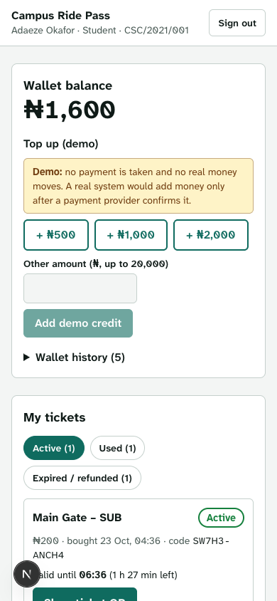
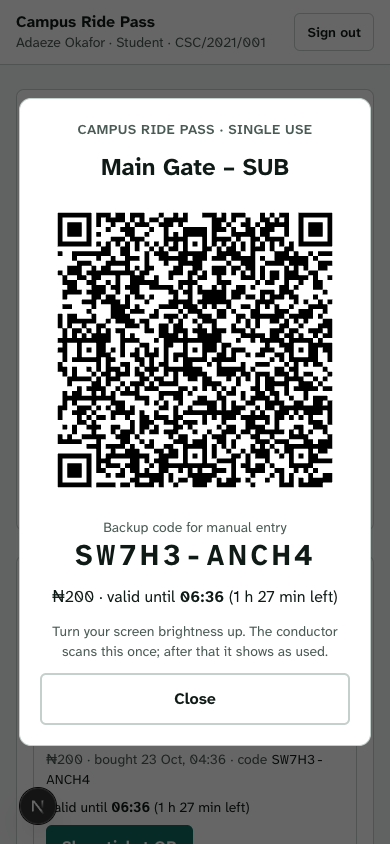
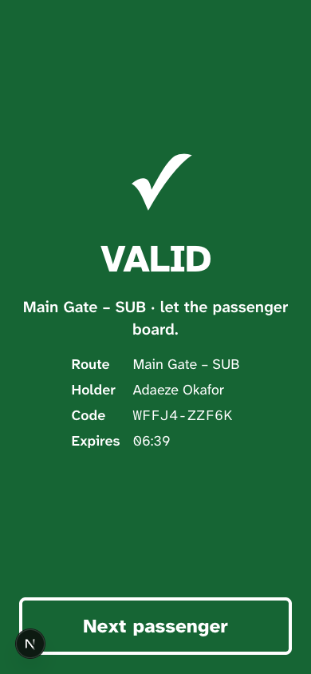
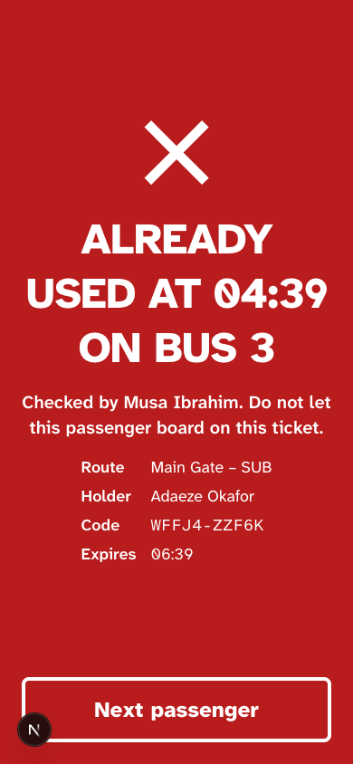
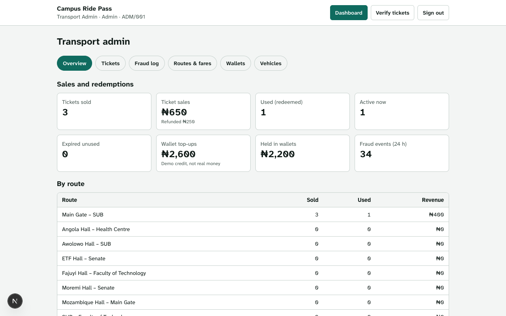

# SCTPSTVS · Secure Campus Transport Payment and Single-Use Ticket Verification System

A SWEP Group 15 project at Obafemi Awolowo University (OAU), Ile-Ife. In the app it is called **Campus Ride Pass**.

Students pay for campus shuttle rides from a wallet and get a ticket with a signed QR code. Conductors scan it on the bus. Each ticket works once and only until it expires, so fake, edited or reused tickets are caught.

> **Demo only.** No real money moves. Wallet top-ups are a clearly labelled demo flow, and the route fares are made-up demo values, **not OAU's real fares**. The app does not connect to any payment provider.

| Student wallet | Ticket QR | Conductor: valid | Conductor: reused |
| --- | --- | --- | --- |
|  |  |  |  |



## Features

Working now:

- **Accounts and roles.** Students sign in with their matriculation number; conductors and admins use a staff number. Passwords are hashed with scrypt and a random salt. Sessions use an httpOnly, SameSite=Lax cookie, and only a SHA-256 hash of the session token is stored.
- **Wallet.** Balance in naira, derived from an append-only ledger of top-ups, ticket purchases and refunds. The database refuses any ledger row that would make a balance negative, and refuses to update or delete ledger rows.
- **Demo top-up** for students, plus **admin credits** (for example, cash paid at a transport office).
- **Routes and fares** between the Main Gate, SUB, the halls (Moremi, Awolowo, Fajuyi, ETF, Angola, Mozambique), the Faculty of Technology, Senate and the Health Centre. Admins can change fares, add routes and take routes off sale.
- **Buying a ticket.** Pick a route and pay from the wallet. The server charges the fare stored for that route and ignores any amount the client sends. The ticket has a unique ID, a 2-hour expiry (configurable) and an Ed25519-signed token. The token is shown as a QR code, with a 10-character backup code for manual entry.
- **My tickets.** Active, used and expired or refunded tickets, with a live countdown and a full-screen QR view.
- **Conductor screen.** Choose the vehicle, then scan the QR with the phone camera or type the backup code. Large, high-contrast result screens read at a glance: **VALID**, **ALREADY USED at 10:42 on Bus 3**, **EXPIRED**, **WRONG ROUTE** and **INVALID**. Each result also has its own vibration pattern.
- **Admin dashboard.** Sales and redemption totals, a per-route table, a ticket list filtered by status, route and search, refunds of unused tickets, a fraud log, route and fare management, wallet credits and vehicle-to-route assignment.
- **Security basics.** Rate limits on sign-in and verification. A fraud log of invalid signatures, unknown codes, reuse attempts, expired or refunded tickets, wrong-route scans and rate-limit hits. Cross-site write protection. Atomic, race-safe purchases and redemptions.
- **Accessible, mobile-first UI.** Semantic HTML, labelled fields, visible focus, keyboard-operable tabs, live regions for results, light and dark themes, and layouts that work at phone width. It uses the Atkinson Hyperlegible font, with a mono cut that keeps 0/O and 1/I distinct in backup codes.

## Status

The MVP is complete: everything in the brief works end to end on a local server. See [Limitations](#limitations) for what a real deployment would still need.

## How to run

You need **Node.js 22.13 or later**, because the app uses the built-in `node:sqlite` module and needs no native build. Node prints an `ExperimentalWarning` for SQLite; this is expected.

```bash
cd sctpstvs
npm install
npm run dev            # http://localhost:3000
```

Other commands:

```bash
npm test               # Vitest unit tests
npx tsc --noEmit       # type check
npx eslint src         # lint
npm run build && npm start   # production build and server
```

On first run the app creates `data/`, which holds:

- `data/sctpstvs.db`: the SQLite database, seeded with the demo accounts, routes and vehicles below;
- `data/keys/ticket-signing-key.pem`: the Ed25519 private key (file mode 0600), plus the public key.

`data/` is git-ignored, and the key must never be committed. Delete `data/` to start again with fresh demo data and a new key. (Old tickets then stop verifying, which is correct.)

Settings (environment variables, all optional):

| Variable | Default | Meaning |
| --- | --- | --- |
| `TICKET_TTL_MINUTES` | `120` | How long a ticket is valid after purchase |
| `SCT_DATA_DIR` | `./data` | Where the database and keys live |
| `SCT_DB_FILE` | `$SCT_DATA_DIR/sctpstvs.db` | Database file (`:memory:` is used by tests) |

### Using the camera on a phone

Browsers only allow the camera on HTTPS pages or on `localhost`. To test scanning from a phone on the same Wi-Fi, run `npx next dev --experimental-https` and open the `https://<your-computer's-IP>:3000` address on the phone, accepting the self-signed certificate warning. Without the camera, the conductor can always type the backup code.

## Demo accounts

| Role | Matric / staff number | Password | Notes |
| --- | --- | --- | --- |
| Student | `CSC/2021/001` | `student123` | Starts with ₦2,000 demo balance |
| Student | `EEG/2022/014` | `student123` | Starts with ₦100, below every fare, to show "insufficient funds" |
| Conductor | `CON/001` | `conductor123` | Verifies tickets |
| Admin | `ADM/001` | `admin123` | Dashboard; can also verify tickets |

These passwords exist only for the demo. Numbers are not case-sensitive.

Demo routes (fares are **example values only**): Main Gate – SUB ₦200, SUB – Faculty of Technology ₦150, Moremi Hall – Senate ₦150, Awolowo Hall – SUB ₦150, Fajuyi Hall – Faculty of Technology ₦150, ETF Hall – Senate ₦200, Angola Hall – Health Centre ₦150, Mozambique Hall – Main Gate ₦250.

Demo vehicles: Bus 1 and Bus 3 (Main Gate – SUB), Bus 2 (SUB – Faculty of Technology), Bus 4 (Moremi Hall – Senate), and Shuttle 5 (any route).

### A two-minute demo

1. Sign in as `CSC/2021/001`, buy a Main Gate – SUB ticket and tap **Show ticket QR**.
2. In another browser (or a private window), sign in as `CON/001`, choose **Bus 1**, and scan the QR or type the backup code. The result is **VALID**.
3. Check the same ticket again. The result is **ALREADY USED at … on Bus 1**.
4. Choose **Bus 4** and check a new Main Gate – SUB ticket. The result is **WRONG ROUTE**, and the ticket stays unused.
5. Sign in as `ADM/001` to see the sales totals, the ticket list and the fraud log entries these checks created.

## How the ticket security works

### 1. A signature makes tickets unforgeable

When a ticket is bought, the server creates a token:

```
SCT1.<payload>.<signature>
```

- `payload` is base64url JSON: `{ tid, rid, iat, exp, kid }`. These are the ticket ID (96 random bits), route ID, issue and expiry times, and a fingerprint of the signing key.
- `signature` is an **Ed25519** signature (Node `crypto.sign`) over `SCT1.<payload>`, made with a private key that only the server holds.

Changing any character of the payload or the signature makes verification fail. The result is **INVALID**, and an "Invalid signature" entry goes in the fraud log. Without the private key, nobody can make a new ticket, extend an expiry or move a ticket to another route.

**Why Ed25519 rather than HMAC?** With HMAC, anyone able to *check* a ticket could also *create* one. With Ed25519 the verifying key is public (`GET /api/public-key`), so a future offline scanner or a third party could check signatures without being able to mint tickets.

### 2. The database makes tickets single-use

A valid signature only proves that the server issued the ticket. Whether it is still unused lives in the database. The final step of a verification is one conditional update:

```sql
UPDATE tickets SET status = 'redeemed', redeemed_at = ?, redeemed_by = ?, redeemed_vehicle = ?
WHERE id = ? AND status = 'active' AND expires_at > ?
```

SQLite applies this atomically. If two conductors scan the same ticket at the same instant, from the same server or from two processes, exactly one update changes a row and gets **VALID**. The other sees zero changed rows and gets **ALREADY USED**, with the time, vehicle and conductor of the first scan. Every reuse attempt is logged.

### 3. Expiry

Each ticket expires `TICKET_TTL_MINUTES` after purchase (2 hours by default). The expiry is inside the signed payload *and* in the database. A ticket past its expiry shows **EXPIRED** and is never marked used. An admin can refund an unused or expired ticket. A refunded ticket shows **INVALID**.

### 4. The backup code

The 10-character code (for example `SW7H3-ANCH4`) uses Crockford base32. There are no I, L, O or U, and look-alike letters typed by mistake are corrected. It carries 50 random bits. It is a lookup key, not a signature. Guessing a valid code would take on the order of 10¹⁵ tries, and verification is limited to 30 checks per conductor per minute. The stored token's signature is still re-checked when a code is used.

### 5. Money

- The client only ever sends a **route ID**. The fare comes from the `routes` table at purchase time, and the ticket records the fare actually paid.
- The balance check, the ledger debit and the ticket insert run in **one `BEGIN IMMEDIATE` transaction**, which takes SQLite's write lock. Ten simultaneous purchases on a wallet that can afford one produce exactly one ticket (this is tested).
- The ledger is **append-only**: database triggers reject `UPDATE` and `DELETE`. A trigger also rejects any row that would take a balance below zero. A `CHECK` constraint keeps purchases negative and top-ups and refunds positive.

### 6. Other protections

- **Rate limits:** 5 sign-in attempts per account and 30 per IP address per 15 minutes, and 30 verifications per conductor per minute. The first refusal in each window is written to the fraud log.
- **Sessions:** a random 256-bit token in an httpOnly, SameSite=Lax cookie (Secure in production). It expires after 12 hours, and sign-out deletes it on the server.
- **Timing:** a sign-in with an unknown number still runs scrypt, so response times don't reveal which numbers exist.
- **Cross-site writes:** requests with an `Origin` header from another site are refused with 403.
- **Roles:** every API route checks the user's role on the server. The UI only hides what a user cannot use.

## API routes

All bodies are JSON. Amounts are returned in **kobo** (₦1 = 100 kobo) and accepted in whole naira.

| Method and path | Who | Purpose |
| --- | --- | --- |
| `POST /api/auth/login` | anyone | `{ matric, password }` → sets the session cookie |
| `POST /api/auth/logout` | anyone | Ends the session |
| `GET /api/auth/me` | signed in | The current user |
| `GET /api/routes` | anyone | Routes on sale, with fares |
| `GET /api/wallet` | student | Balance and recent ledger entries |
| `POST /api/wallet/topup` | student | `{ amountNaira }`: **demo** credit, up to ₦20,000 |
| `GET /api/tickets` | student | Own tickets, including tokens for the QR code |
| `POST /api/tickets` | student | `{ routeId }`: buy a ticket at the server's fare |
| `GET /api/vehicles` | conductor, admin | Vehicles and their routes |
| `POST /api/verify` | conductor, admin | `{ code, vehicleId? }` → `{ outcome, headline, detail, ticket?, holderName? }` |
| `GET /api/public-key` | anyone | The Ed25519 public key (PEM) and key ID |
| `GET /api/admin/stats` | admin | Sales, redemption, wallet and fraud totals, per route |
| `GET /api/admin/tickets` | admin | `?status=active\|redeemed\|expired\|refunded&routeId=&q=` |
| `POST /api/admin/tickets/:id/refund` | admin | Refund an unused ticket to the wallet |
| `GET /api/admin/fraud` | admin | Fraud log, `?kind=` to filter |
| `GET, POST /api/admin/routes` | admin | All routes, or add one `{ name, origin, destination, fareNaira }` |
| `PATCH /api/admin/routes/:id` | admin | Change `fareNaira`, `active`, `name`, `origin` or `destination` |
| `GET /api/admin/wallets` | admin | Student balances |
| `POST /api/admin/credit` | admin | `{ matric, amountNaira, note? }` |
| `POST /api/admin/vehicles` | admin | `{ name, routeId \| null }` |
| `PATCH /api/admin/vehicles/:id` | admin | `{ routeId \| null }` |

`outcome` is one of `valid`, `already_used`, `expired`, `wrong_route` or `invalid`.

## Tests

`npm test` runs 32 Vitest tests in four files:

- `src/lib/server/tokens.test.ts`: signing and verification, edited payload or signature rejected, wrong key rejected, malformed input, backup code format and normalisation.
- `src/lib/server/tickets.test.ts`: the fare comes from the route, insufficient funds, ten concurrent purchases on a one-ticket balance, the ledger never going negative (even with a direct insert), the ledger being append-only, single use with the "ALREADY USED at 10:42 on Bus 3" message, the backup code, expiry, tampered, forged and unknown codes (and their fraud log entries), wrong route, twenty simultaneous scans with exactly one VALID, two separate database connections racing to redeem, and refunds.
- `src/lib/server/auth.test.ts`: scrypt hashing, sign-in, session expiry and revocation, and the rate limiter.
- `src/app/api/tickets/route.test.ts`: calls the real route handler with `fareKobo: 1` in the body and checks the full server fare is charged. It also checks sign-in and role rules and the cross-site block, and that an issued ticket verifies exactly once through `/api/verify`.

## Project layout

```
src/
  app/                    pages (/, /student, /conductor, /admin) and API route handlers
  components/             shared UI: role gate, header, QR code, badges, demo banner
  lib/                    shared types, labels, money and time formatting
  lib/client/             browser helpers: API fetch, shared clock, localStorage setting
  lib/server/             server-only: database, seed, keys, tokens, tickets, wallet,
                          catalog (routes, vehicles), auth, rate limit, fraud log, stats
data/                     runtime database and signing key (git-ignored)
```

## Limitations

- **No real payments.** Top-ups are demo credits. A real system would credit the wallet only after a payment provider confirms the payment through a signed webhook. Admin credits stand in for cash paid at an office.
- **Fares, routes and vehicles are invented** for the demo and are not OAU's real ones.
- **Verification needs the server.** The QR signature could be checked offline with the public key, but single use needs the central database. An offline scanner would have to sync and accept a small risk of reuse.
- **One server.** SQLite and the in-memory rate limiter suit a single server. Several instances would need a shared database (for example PostgreSQL, using the same conditional `UPDATE`) and a shared rate-limit store.
- **Rate limits are keyed by IP address and account.** Behind a proxy, `x-forwarded-for` must be set by a trusted proxy.
- **One signing key and no rotation UI.** The `kid` field allows rotation later. Losing the key file invalidates all outstanding tickets.
- **No self-registration or password reset.** Accounts are seeded. A real deployment would link to the university's student records.
- **A screenshot of a QR still works once.** A student can pass their ticket to a friend before it is used. That is allowed (it was paid for), but it can only be used once.
- The camera scanner needs HTTPS (or localhost), and headless testing could not exercise a real camera. Scanning was tested with typed codes and through the same `/api/verify` endpoint the scanner calls.
